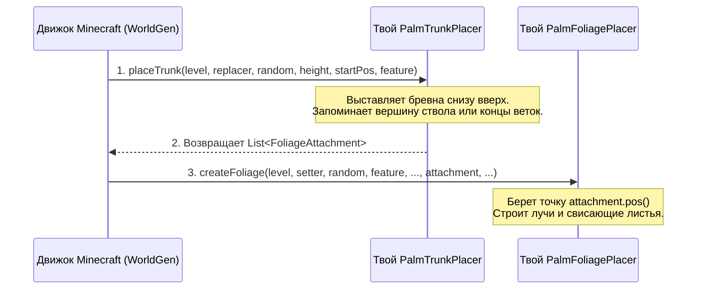
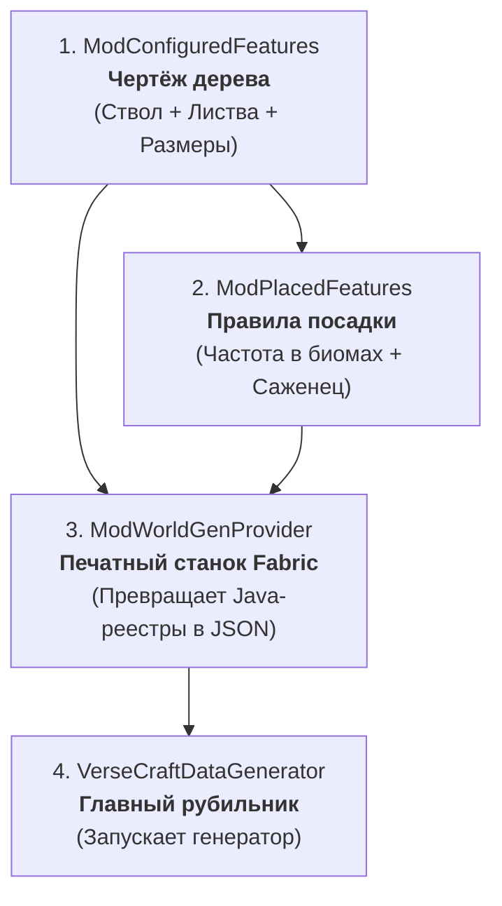

    # Руководство: Уникальные TrunkPlacer и FoliagePlacer (Minecraft 26.3 + DataGen)

> [!TIP]
> **Ищешь руководство без сложной математики и заумных терминов?**
> Читай понятный гайд для начинающих с кубиками LEGO и командами Minecraft:
> 👉 **[Руководство по деревьям «Для Чайников» (TREE_GUIDE_BEGINNERS.md)](file:///C:/Users/serge/Desktop/VerseCraft/docs/TREE_GUIDE_BEGINNERS.md)**


> [!IMPORTANT]
> **Специфика маппингов Minecraft 26.3 (Fabric / Mojmap):**
> В версии **26.3** Mojang кардинально обновил систему генерации деревьев:
> 1. Класс `TreeConfiguration` упразднен и объединен в запись `TreeFeature` (`TreeFeature` теперь сам реализует `Feature`).
> 2. `Registries.CONFIGURED_FEATURE` заменен на прямой реестр **`Registries.FEATURE`** с ключом `ResourceKey<Feature>`.
> 3. В `TrunkPlacer`: метод называется **`placeTrunk`** (вместо старого `placeLogs`), первым аргументом передается **`WorldGenLevel`**, а конфиг заменен на **`TreeFeature`**.
> 4. В `FoliagePlacer`: метод установки листа называется **`tryPlaceLeaf`** (вместо `placeFoliageLeavesBlock`).
> 5. В `TreeGrower`: списки деревьев используют **`WeightedList<ResourceKey<Feature>>`**.

Ниже приведено полное, 100% точное руководство именно под маппинги и кодовую базу **Minecraft 26.3**.

---

## 1. Связка: как ствол передает координаты листве



---

## 2. Создание уникального ствола (`PalmTrunkPlacer`) под 26.3

### 2.1. Исходный код `PalmTrunkPlacer.java`
Создай файл в `src/main/java/net/sergofoox/versecraft/worldgen/tree/trunk/PalmTrunkPlacer.java`:

```java
package net.sergofoox.versecraft.worldgen.tree.trunk;

import com.mojang.serialization.MapCodec;
import com.mojang.serialization.codecs.RecordCodecBuilder;
import net.minecraft.core.BlockPos;
import net.minecraft.core.Direction;
import net.minecraft.util.RandomSource;
import net.minecraft.util.valueproviders.IntProvider;
import net.minecraft.util.valueproviders.IntProviders;
import net.minecraft.world.level.WorldGenLevel;
import net.minecraft.world.level.block.RotatedPillarBlock;
import net.minecraft.world.level.block.state.BlockState;
import net.minecraft.world.level.levelgen.feature.TreeFeature;
import net.minecraft.world.level.levelgen.feature.foliageplacers.FoliagePlacer;
import net.minecraft.world.level.levelgen.feature.trunkplacers.TrunkPlacer;
import net.minecraft.world.level.levelgen.feature.trunkplacers.TrunkPlacerType;
import net.sergofoox.versecraft.registry.ModTreePlacers;

import java.util.ArrayList;
import java.util.List;
import java.util.function.BiConsumer;

public class PalmTrunkPlacer extends TrunkPlacer {

    // 1. КОДЕК: сериализация параметров в JSON для DataGen
    public static final MapCodec<PalmTrunkPlacer> CODEC = RecordCodecBuilder.mapCodec(instance ->
        trunkPlacerParts(instance)
            .and(IntProvider.codec(1, 4).fieldOf("bend_length").forGetter(p -> p.bendLength))
            .apply(instance, PalmTrunkPlacer::new)
    );

    // Дополнительный параметр: на сколько блоков ствол сместится в сторону
    private final IntProvider bendLength;

    public PalmTrunkPlacer(int baseHeight, int heightRandA, int heightRandB, IntProvider bendLength) {
        super(baseHeight, heightRandA, heightRandB);
        this.bendLength = bendLength;
    }

    @Override
    protected TrunkPlacerType<?> type() {
        return ModTreePlacers.PALM_TRUNK_PLACER;
    }

    @Override
    public List<FoliagePlacer.FoliageAttachment> placeTrunk(
            WorldGenLevel level,
            BiConsumer<BlockPos, BlockState> replacer,
            RandomSource random,
            int height,
            BlockPos startPos,
            TreeFeature feature // В 26.3 вместо TreeConfiguration используется TreeFeature
    ) {
        // Устанавливаем блок земли под стволом
        placeBelowTrunkBlock(level, replacer, random, startPos.below(), feature);

        List<FoliagePlacer.FoliageAttachment> attachments = new ArrayList<>();
        BlockPos.MutableBlockPos currentPos = startPos.mutable();

        // Выбираем случайную сторону наклона (Север, Юг, Восток или Запад)
        Direction bendDirection = Direction.Plane.HORIZONTAL.getRandomDirection(random);
        int maxBend = this.bendLength.sample(random); // 1..2 блока
        int bendInterval = Math.max(1, height / (maxBend + 1));
        int currentBend = 0;

        for (int y = 0; y < height; y++) {
            // Ставим бревно на текущей позиции
            this.placeLog(level, replacer, random, currentPos, feature);

            // Плавно изгибаем ствол в процессе роста
            if (y > 2 && y % bendInterval == 0 && currentBend < maxBend) {
                currentPos.move(bendDirection);
                currentBend++;

                // Ставим бревно с соответствующей осью наклона
                Direction.Axis axis = bendDirection.getAxis();
                this.placeLog(level, replacer, random, currentPos, feature, state ->
                    state.hasProperty(RotatedPillarBlock.AXIS) ? state.setValue(RotatedPillarBlock.AXIS, axis) : state
                );
            }

            // Растем вверх
            currentPos.move(Direction.UP);
        }

        // Вершина ствола — точка, куда прикрепится крона
        attachments.add(new FoliagePlacer.FoliageAttachment(currentPos.immutable(), 0, false));

        return attachments;
    }
}
```

---

## 3. Создание уникальной кроны (`PalmFoliagePlacer`) под 26.3

### 3.1. Исходный код `PalmFoliagePlacer.java`
Создай файл в `src/main/java/net/sergofoox/versecraft/worldgen/tree/foliage/PalmFoliagePlacer.java`:

```java
package net.sergofoox.versecraft.worldgen.tree.foliage;

import com.mojang.serialization.MapCodec;
import com.mojang.serialization.codecs.RecordCodecBuilder;
import net.minecraft.core.BlockPos;
import net.minecraft.core.Direction;
import net.minecraft.util.RandomSource;
import net.minecraft.util.valueproviders.IntProvider;
import net.minecraft.util.valueproviders.IntProviders;
import net.minecraft.world.level.WorldGenLevel;
import net.minecraft.world.level.levelgen.feature.TreeFeature;
import net.minecraft.world.level.levelgen.feature.foliageplacers.FoliagePlacer;
import net.minecraft.world.level.levelgen.feature.foliageplacers.FoliagePlacerType;
import net.sergofoox.versecraft.registry.ModTreePlacers;

public class PalmFoliagePlacer extends FoliagePlacer {

    public static final MapCodec<PalmFoliagePlacer> CODEC = RecordCodecBuilder.mapCodec(instance -> 
        foliagePlacerParts(instance).apply(instance, PalmFoliagePlacer::new)
    );

    public PalmFoliagePlacer(IntProvider radius, IntProvider offset) {
        super(radius, offset);
    }

    @Override
    protected FoliagePlacerType<?> type() {
        return ModTreePlacers.PALM_FOLIAGE_PLACER;
    }

    @Override
    public int foliageHeight(RandomSource random, int height, TreeFeature feature) {
        return 3; // Высота шапки листьев
    }

    @Override
    protected boolean shouldSkipLocation(RandomSource random, int localX, int localY, int localZ, int range, boolean large) {
        return false; // Строим листья вручную по точным координатам
    }

    @Override
    protected void createFoliage(
            WorldGenLevel level,
            FoliageSetter foliageSetter,
            RandomSource random,
            TreeFeature feature,
            int maxFreeTreeHeight,
            FoliageAttachment attachment,
            int foliageHeight,
            int radius, // Длина ветвей (из DataGen)
            int offset
    ) {
        BlockPos center = attachment.pos();

        // 1. Верхушка на 1 блок над стволом (крестик 3х3)
        BlockPos top = center.above();
        tryPlaceLeaf(level, foliageSetter, random, feature, top);
        for (Direction dir : Direction.Plane.HORIZONTAL) {
            tryPlaceLeaf(level, foliageSetter, random, feature, top.relative(dir));
        }

        // 2. 4 основных луча (N, S, E, W) с каскадным свисанием вниз
        for (Direction dir : Direction.Plane.HORIZONTAL) {
            for (int i = 1; i <= radius; i++) {
                tryPlaceLeaf(level, foliageSetter, random, feature, center.relative(dir, i));
            }
            // Первый изгиб вниз
            BlockPos drop1 = center.relative(dir, radius).below();
            tryPlaceLeaf(level, foliageSetter, random, feature, drop1);

            // Кончик ветви опускается еще на 1 блок ниже
            BlockPos dropTip = center.relative(dir, radius + 1).below(2);
            tryPlaceLeaf(level, foliageSetter, random, feature, dropTip);
        }

        // 3. 4 диагональных луча
        int[][] diagonals = { {1, 1}, {1, -1}, {-1, 1}, {-1, -1} };
        int diagLength = Math.max(2, radius - 1);

        for (int[] d : diagonals) {
            int dx = d[0];
            int dz = d[1];
            for (int i = 1; i <= diagLength; i++) {
                tryPlaceLeaf(level, foliageSetter, random, feature, center.offset(dx * i, 0, dz * i));
            }
            // Кончик диагонали загибается вниз
            BlockPos diagTip = center.offset(dx * (diagLength + 1), -1, dz * (diagLength + 1));
            tryPlaceLeaf(level, foliageSetter, random, feature, diagTip);
        }
    }
}
```

---


### 3.2. Геометрия листвы: подробнейший разбор циклов for и 3D-координат

Для человека, изучающего Java, генерация листвы может казаться сложной, но на самом деле это **обычная геометрия на сетке из кубиков**. Давай разберём всё по косточкам с нуля.

---

#### 1. Как устроен мир блоков (Класс `BlockPos`)
В Minecraft мир — это огромная трехмерная сетка целых чисел `(X, Y, Z)`:
- **`X`** — координата Запад <---> Восток.
- **`Y`** — координата Вниз <---> Вверх (высота).
- **`Z`** — координата Север <---> Юг.

Точка **`center = attachment.pos()`** — это `BlockPos`, который передал ствол дерева. Это верхняя точка ствола, откуда должна расти листва.

Основные методы перемещения от `BlockPos`:
- `center.above()` — подняться на 1 блок вверх по `Y` (или `.above(n)` на `n` блоков).
- `center.below()` — опуститься на 1 блок вниз по `Y` (или `.below(n)`).
- `center.relative(Direction.NORTH, 2)` — шагнуть на 2 блока на Север (по `Z`).
- `center.offset(dx, dy, dz)` — прибавить смещение к координатам: `X + dx`, `Y + dy`, `Z + dz`.

---

#### 2. Один цикл `for`: Рисуем прямую линию (Ветку)
Представь, что мы стоим в центре и хотим протянуть ветку на Восток длиной 3 блока:

```java
// Цикл сделает 3 итерации: step = 1, затем step = 2, затем step = 3
for (int step = 1; step <= 3; step++) {
    BlockPos leafPos = center.relative(Direction.EAST, step);
    tryPlaceLeaf(level, foliageSetter, random, feature, leafPos);
}
```
**Что происходит по шагам:**
1. `step = 1`: берем блок `(center.x + 1, center.y, center.z)`, ставим листву.
2. `step = 2`: берем блок `(center.x + 2, center.y, center.z)`, ставим листву.
3. `step = 3`: берем блок `(center.x + 3, center.y, center.z)`, ставим листву.
4. `step = 4`: условие `step <= 3` ложно, цикл завершился.
**Итог:** получилась прямая горизонтальная палочка из листьев длиной 3 блока.

---

#### 3. Два вложенных цикла `for`: Рисуем квадратную плоскость (Ковёр)
А что, если нам нужен плоский слой листьев (например, квадрат 3х3 вокруг центра)?
Для этого нужен цикл в цикле: внешний перебирает строки (`X`), внутренний — столбцы (`Z`).

```java
int radius = 1; // Радиус 1 означает от -1 до +1 (итого 3 блока в ширину)

for (int x = -radius; x <= radius; x++) {       // x принимает значения: -1, 0, 1
    for (int z = -radius; z <= radius; z++) {   // z принимает значения: -1, 0, 1
        BlockPos leafPos = center.offset(x, 0, z); // Y = 0 (на одном уровне)
        tryPlaceLeaf(level, foliageSetter, random, feature, leafPos);
    }
}
```

**Таблица работы вложенных циклов:**
| Итерация | X | Z | Позиция блока относительно центра |
|---|---|---|---|
| 1 | -1 | -1 | Северо-западный угол |
| 2 | -1 | 0  | Западная сторона |
| 3 | -1 | 1  | Юго-западный угол |
| 4 | 0  | -1 | Северная сторона |
| 5 | 0  | 0  | **Сам центр** |
| 6 | 0  | 1  | Южная сторона |
| 7 | 1  | -1 | Северо-восточный угол |
| 8 | 1  | 0  | Восточная сторона |
| 9 | 1  | 1  | Юго-восточный угол |

Итог: поставлено ровно $3 \times 3 = 9$ блоков в форме квадрата.

---

#### 4. Как превратить квадрат в круг (Срезание углов)
Квадратная листва выглядит неестественно. Чтобы скруглить квадрат, мы просто **пропускаем 4 угловых блока** с помощью оператора `continue`:

```java
for (int x = -radius; x <= radius; x++) {
    for (int z = -radius; z <= radius; z++) {

        // Углы квадрата - это точки, где |x| максимален И |z| максимален:
        // (-1,-1), (-1,1), (1,-1), (1,1)
        if (Math.abs(x) == radius && Math.abs(z) == radius) {
            continue; // Пропускаем этот шаг цикла, лист НЕ ставится!
        }

        BlockPos leafPos = center.offset(x, 0, z);
        tryPlaceLeaf(level, foliageSetter, random, feature, leafPos);
    }
}
```

**Было (квадрат 9 блоков):**
```text
[X] [O] [X]      X = угол (пропущен)
[O] [O] [O]      O = блок листвы
[X] [O] [X]
```
**Стало (аккуратный крестик/круг из 5 блоков):**
```text
    [O]
[O] [O] [O]
    [O]
```

---

#### 5. Три вложенных цикла: Объёмный шар (Стопка блинчиков)
Как устроен шар листвы обычного дуба? Это просто **стопка из нескольких круглых слоев по высоте Y**:
1. Верхний слой (`y = 2`): маленький радиус 1.
2. Средний слой (`y = 1`): широкий радиус 2 (пузико шара).
3. Нижний слой (`y = 0`): радиус 1.

```java
for (int y = 0; y <= 2; y++) {
    // Выбираем радиус слоя в зависимости от высоты:
    int r = (y == 1) ? 2 : 1; 

    for (int x = -r; x <= r; x++) {
        for (int z = -r; z <= r; z++) {
            if (Math.abs(x) == r && Math.abs(z) == r) {
                continue; // скругляем каждый слой
            }
            // Смещаемся не только по X и Z, но и по высоте Y:
            BlockPos leafPos = center.offset(x, y, z);
            tryPlaceLeaf(level, foliageSetter, random, feature, leafPos);
        }
    }
}
```

---

#### 6. Лучевой алгоритм (Пальма): шаг за шагом
Пальма не похожа на шар. Её листья — это **отдельные расходящиеся ветви (вайи)**, которые растут из одной точки и красиво изгибаются к земле.

Поэтому здесь мы используем **лучевой подход**:

##### Шаг А: 4 кардинальных луча (Север, Юг, Восток, Запад)
Вместо перебора сетки `x/z` мы берем готовый массив направлений `Direction.Plane.HORIZONTAL`:
```java
for (Direction dir : Direction.Plane.HORIZONTAL) {
    // 1. Прямой горизонтальный луч из центра длиной radius
    for (int i = 1; i <= radius; i++) {
        tryPlaceLeaf(level, foliageSetter, random, feature, center.relative(dir, i));
    }

    // 2. Первый изгиб вниз на самом краю луча:
    BlockPos drop1 = center.relative(dir, radius).below();
    tryPlaceLeaf(level, foliageSetter, random, feature, drop1);

    // 3. Кончик листа опускается еще на 1 блок ниже и отступает дальше:
    BlockPos tip = center.relative(dir, radius + 1).below(2);
    tryPlaceLeaf(level, foliageSetter, random, feature, tip);
}
```

##### Шаг Б: 4 диагональных луча
Между сторонами света (север, юг и т.д.) есть промежутки. Чтобы пальма была пышной со всех 360 градусов, добавляем диагонали:
Диагональ — это одновременное смещение и по `X`, и по `Z`:
- `( 1,  1)` — Северо-Восток
- `( 1, -1)` — Юго-Восток
- `(-1,  1)` — Северо-Запад
- `(-1, -1)` — Юго-Запад

```java
int[][] diagonals = { {1, 1}, {1, -1}, {-1, 1}, {-1, -1} };
int diagLength = Math.max(2, radius - 1);

for (int[] d : diagonals) {
    int dx = d[0];
    int dz = d[1];

    // Шагаем по диагонали наружу
    for (int i = 1; i <= diagLength; i++) {
        BlockPos pos = center.offset(dx * i, 0, dz * i);
        tryPlaceLeaf(level, foliageSetter, random, feature, pos);
    }

    // Кончик диагонали загибаем вниз на 1 блок
    BlockPos diagTip = center.offset(dx * (diagLength + 1), -1, dz * (diagLength + 1));
    tryPlaceLeaf(level, foliageSetter, random, feature, diagTip);
}
```

---

#### 7. Шпаргалка: Как придумать свою форму листвы

| Какую форму ты хочешь | Как настроить циклы `for` |
|---|---|
| **Конус (Ель / Сосна)** | Цикл по `Y` снизу вверх: на каждом слое `y++` радиус уменьшается: `r = baseRadius - y`. Снизу широкий блин, сверху остриё в 1 блок. |
| **Плакучая ива** | Строишь обычный шар, а на самых дальних блоках добавляешь цикл вниз: `for (int down = 1; down <= 3; down++) tryPlaceLeaf(..., pos.below(down));`. |
| **Плоский зонтик (Саванна / Акация)** | Только 1 или 2 тонких слоя по `Y`, но с большим радиусом `r = 3..4`, плюс маленькая шапочка сверху. |
| **Звезда / Пальма** | Лучи из центра через `center.relative(dir, step)` со свисающими кончиками через `.below()`. |

---

## 4. Регистрация в реестрах игры (`ModTreePlacers.java`)

```java
package net.sergofoox.versecraft.registry;

import net.minecraft.core.Registry;
import net.minecraft.core.registries.BuiltInRegistries;
import net.minecraft.world.level.levelgen.feature.foliageplacers.FoliagePlacerType;
import net.minecraft.world.level.levelgen.feature.trunkplacers.TrunkPlacerType;
import net.sergofoox.versecraft.VerseCraft;
import net.sergofoox.versecraft.worldgen.tree.foliage.PalmFoliagePlacer;
import net.sergofoox.versecraft.worldgen.tree.trunk.PalmTrunkPlacer;

public class ModTreePlacers {

    public static final TrunkPlacerType<PalmTrunkPlacer> PALM_TRUNK_PLACER = 
        Registry.register(
            BuiltInRegistries.TRUNK_PLACER_TYPE,
            VerseCraft.id("palm_trunk_placer"),
            new TrunkPlacerType<>(PalmTrunkPlacer.CODEC)
        );

    public static final FoliagePlacerType<PalmFoliagePlacer> PALM_FOLIAGE_PLACER = 
        Registry.register(
            BuiltInRegistries.FOLIAGE_PLACER_TYPE,
            VerseCraft.id("palm_foliage_placer"),
            new FoliagePlacerType<>(PalmFoliagePlacer.CODEC)
        );

    public static void register() {
        VerseCraft.LOGGER.info("Registered 26.3 Tree Placers");
    }
}
```

Не забудь вызвать `ModTreePlacers.register()` в методе `VerseCraft.onInitialize()`.

---

## 5. Сборка дерева через DataGen под 26.3

В версии 26.3 мир Minecraft настраивается через систему **Dynamic Registries** (динамических реестров). Чтобы дерево появилось в игре и могло быть сгенерировано DataGen'ом в JSON-файлы, требуются **3 взаимосвязанных класса**:



### 5.1. `ModConfiguredFeatures.java`: Чертёж дерева
Создай файл `src/main/java/net/sergofoox/versecraft/datagen/worldgen/ModConfiguredFeatures.java`:
Здесь задаётся «рецепт» самого дерева: из какого бревна ствол, какой `TrunkPlacer` его строит, какая листва и какой `FoliagePlacer`.

```java
package net.sergofoox.versecraft.datagen.worldgen;

import net.minecraft.core.registries.Registries;
import net.minecraft.data.worldgen.BootstrapContext;
import net.minecraft.resources.ResourceKey;
import net.minecraft.util.valueproviders.ConstantInt;
import net.minecraft.util.valueproviders.UniformInt;
import net.minecraft.world.level.block.Blocks;
import net.minecraft.world.level.levelgen.feature.Feature;
import net.minecraft.world.level.levelgen.feature.TreeFeature;
import net.minecraft.world.level.levelgen.feature.featuresize.TwoLayersFeatureSize;
import net.minecraft.world.level.levelgen.feature.stateproviders.BlockStateProvider;
import net.sergofoox.versecraft.VerseCraft;
import net.sergofoox.versecraft.registry.RegisterBlocks;
import net.sergofoox.versecraft.worldgen.tree.foliage.PalmFoliagePlacer;
import net.sergofoox.versecraft.worldgen.tree.trunk.PalmTrunkPlacer;

public class ModConfiguredFeatures {

    // В 26.3 ключ регистрируется в Registries.FEATURE с типом Feature
    public static final ResourceKey<Feature> PALM_TREE_KEY =
            ResourceKey.create(Registries.FEATURE, VerseCraft.id("palm_tree"));

    public static void bootstrap(BootstrapContext<Feature> context) {
        Feature palmTree = new TreeFeature.Builder(
                // 1. Блок ствола и TrunkPlacer
                BlockStateProvider.of(RegisterBlocks.PALM_LOG),
                new PalmTrunkPlacer(6, 2, 0, UniformInt.of(1, 2)),
                // 2. Блок листвы и FoliagePlacer
                BlockStateProvider.of(RegisterBlocks.PALM_LEAVES),
                new PalmFoliagePlacer(ConstantInt.of(3), ConstantInt.of(0)),
                // 3. Свободное место вокруг дерева
                new TwoLayersFeatureSize(1, 0, 1),
                // 4. Блок под стволом (земля/песок)
                BlockStateProvider.holderOf(Blocks.DIRT)
        )
                .ignoreVines()
                .build();

        context.register(PALM_TREE_KEY, palmTree);
    }
}
```

### 5.2. `ModPlacedFeatures.java`: Правила посадки
Создай файл `src/main/java/net/sergofoox/versecraft/datagen/worldgen/ModPlacedFeatures.java`:
Здесь чертёж дерева упаковывается в «PlacedFeature» — инструкцию о том, как дерево спавнится в мире (сколько штук на чанк, условия выживания саженца).

```java
package net.sergofoox.versecraft.datagen.worldgen;

import net.minecraft.core.registries.Registries;
import net.minecraft.data.worldgen.BootstrapContext;
import net.minecraft.data.worldgen.placement.PlacementUtils;
import net.minecraft.data.worldgen.placement.VegetationPlacements;
import net.minecraft.resources.ResourceKey;
import net.minecraft.world.level.levelgen.placement.PlacedFeature;
import net.sergofoox.versecraft.VerseCraft;
import net.sergofoox.versecraft.registry.RegisterBlocks;

public class ModPlacedFeatures {

    public static final ResourceKey<PlacedFeature> PALM_TREE_PLACED_KEY =
            ResourceKey.create(Registries.PLACED_FEATURE, VerseCraft.id("palm_tree_placed"));

    public static void bootstrap(BootstrapContext<PlacedFeature> context) {
        var featureLookup = context.lookup(Registries.FEATURE);

        // VegetationPlacements.treePlacement настраивает модификаторы размещения:
        // - PlacementUtils.countExtra(2, 0.1f, 1): частота генерации на чанк
        // - RegisterBlocks.PALM_SAPLING: фильтр проверки (дерево вырастет только там, где саженец может выжить)
        PlacementUtils.register(
                context,
                PALM_TREE_PLACED_KEY,
                featureLookup.getOrThrow(ModConfiguredFeatures.PALM_TREE_KEY),
                VegetationPlacements.treePlacement(
                        PlacementUtils.countExtra(2, 0.1f, 1),
                        RegisterBlocks.PALM_SAPLING
                )
        );
    }
}
```

### 5.3. `ModWorldGenProvider.java`: Экспортёр в JSON
Создай файл `src/main/java/net/sergofoox/versecraft/datagen/worldgen/ModWorldGenProvider.java`:
Это специальный провайдер Fabric (`FabricDynamicRegistryProvider`), который забирает из контекста реестры генерации мира и сохраняет их в `src/main/generated/data/...`. Без него DataGen не знает, что эти деревья нужно сохранять на диск!

```java
package net.sergofoox.versecraft.datagen.worldgen;

import net.fabricmc.fabric.api.datagen.v1.FabricPackOutput;
import net.fabricmc.fabric.api.datagen.v1.provider.FabricDynamicRegistryProvider;
import net.minecraft.core.HolderLookup;
import net.minecraft.core.registries.Registries;

import java.util.concurrent.CompletableFuture;

public class ModWorldGenProvider extends FabricDynamicRegistryProvider {

    public ModWorldGenProvider(FabricPackOutput output, CompletableFuture<HolderLookup.Provider> registriesFuture) {
        super(output, registriesFuture);
    }

    @Override
    protected void configure(HolderLookup.Provider registries, Entries entries) {
        // Добавляем наши фичи деревьев
        entries.addAll(registries.lookupOrThrow(Registries.FEATURE));
        // Добавляем настройки размещения деревьев
        entries.addAll(registries.lookupOrThrow(Registries.PLACED_FEATURE));
    }

    @Override
    public String getName() {
        return "World Gen";
    }
}
```

---

## 6. Саженец (`TreeGrower`) под 26.3

В 26.3 класс `TreeGrower` принимает списки вариантов через `WeightedList`:

```java
import net.minecraft.util.random.WeightedList;
import net.minecraft.world.level.block.grower.TreeGrower;

public class ModTreeGrowers {
    public static final TreeGrower PALM = new TreeGrower(
            "palm",
            WeightedList.of(ModConfiguredFeatures.PALM_TREE_KEY), // Основное дерево
            WeightedList.of(),                                   // Мега 2x2 дерево (если нет, пустой)
            WeightedList.of(),                                   // Дерево с ульем
            ModConfiguredFeatures.PALM_TREE_KEY                  // Дефолтный фоллбэк
    );
}
```

---

## 7. Главная точка входа DataGen (`VerseCraftDataGenerator.java`)

В файле `VerseCraftDataGenerator.java` объединяются две вещи:
1. `pack.addProvider(ModWorldGenProvider::new)` — подключает экспортёр.
2. `buildRegistry(RegistrySetBuilder)` — регистрирует методы bootstrap для создания данных.

```java
package net.sergofoox.versecraft;

import net.fabricmc.fabric.api.datagen.v1.DataGeneratorEntrypoint;
import net.fabricmc.fabric.api.datagen.v1.FabricDataGenerator;
import net.minecraft.core.RegistrySetBuilder;
import net.minecraft.core.registries.Registries;

public class VerseCraftDataGenerator implements DataGeneratorEntrypoint {

    @Override
    public void onInitializeDataGenerator(FabricDataGenerator fabricDataGenerator) {
        FabricDataGenerator.Pack pack = fabricDataGenerator.createPack();
        // Регистрируем провайдер генерации мира (создаст json-файлы)
        pack.addProvider(ModWorldGenProvider::new);
    }

    @Override
    public void buildRegistry(RegistrySetBuilder registryBuilder) {
        // В 26.3 Registries.FEATURE вместо Registries.CONFIGURED_FEATURE
        registryBuilder.add(Registries.FEATURE, ModConfiguredFeatures::bootstrap);
        registryBuilder.add(Registries.PLACED_FEATURE, ModPlacedFeatures::bootstrap);
    }
}
```

### Как запустить генерацию JSON:
В терминале:
```powershell
./gradlew runDatagen
```
После завершения в папке `src/main/generated/data/versecraft/worldgen/` появятся готовые файлы:
* `feature/palm_tree.json` — конфигурация дерева
* `placed_feature/palm_tree_placed.json` — правила размещения
