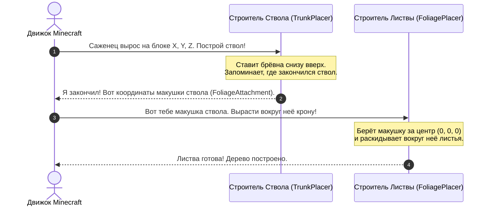
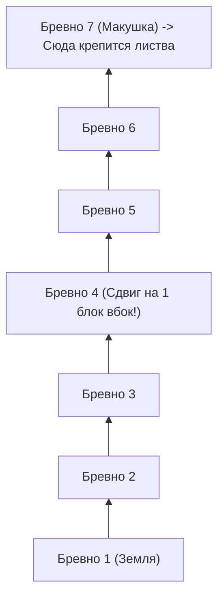
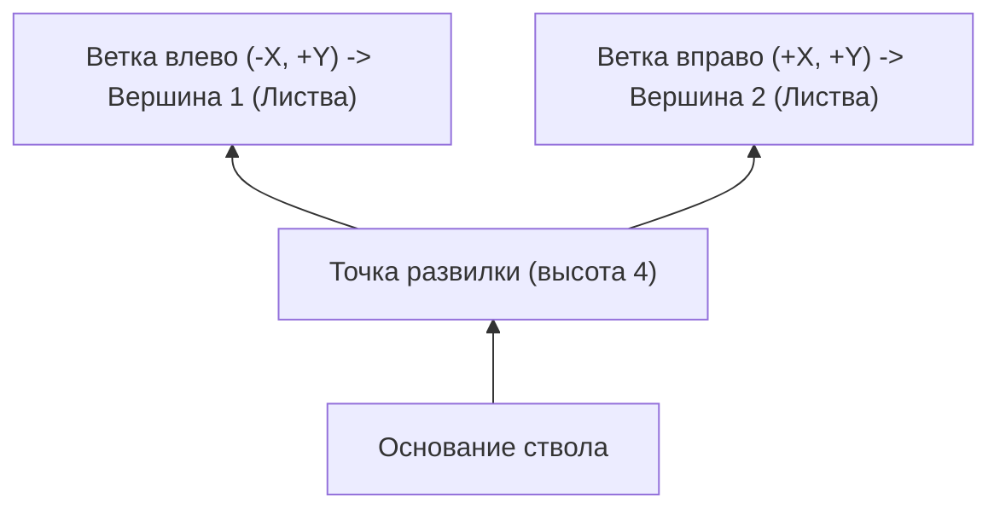
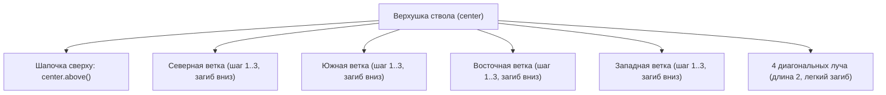
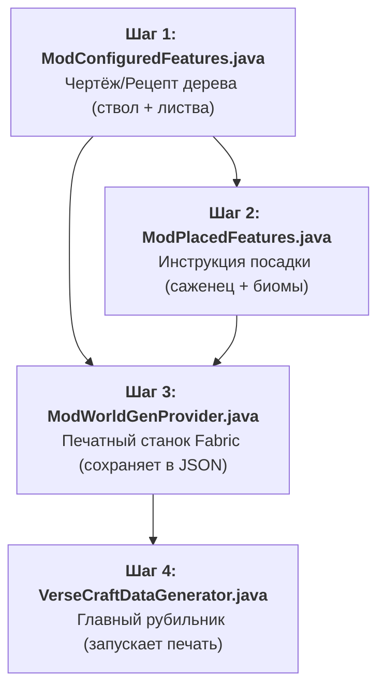
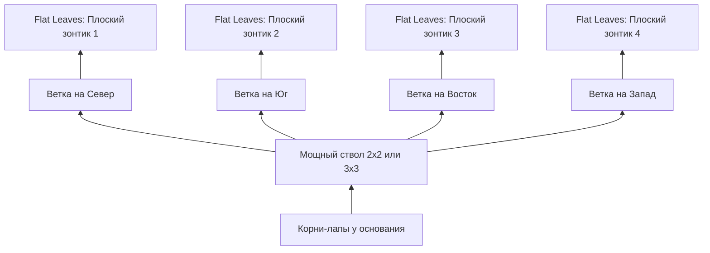

# Руководство по деревьям «Для Чайников»: Стволы и Листва с Нуля (Minecraft 26.3)

> [!NOTE]
> Это руководство написано максимально простым и понятным языком для тех, кто **не знает сложной математики** и только начинает изучать Java. Здесь нет заумных терминов. Всё объясняется через кубики LEGO и координаты из игры.

---

## Оглавление
1. [Главная идея: Всё как в командах Minecraft (~ ~ ~)](#1-главная-идея-всё-как-в-командах-minecraft----)
2. [Кто за что отвечает: Как игра строит дерево](#2-кто-за-что-отвечает-как-игра-строит-дерево)
3. [Как двигаться по блокам в коде (Шпаргалка по BlockPos)](#3-как-двигаться-по-блокам-в-коде-шпаргалка-по-blockpos)
4. [Делаем СВОЙ СТВОЛ (TrunkPlacer)](#4-делаем-свой-ствол-trunkplacer)
   - [Пример 1: Простой прямой ствол](#пример-1-простой-прямой-ствол)
   - [Пример 2: Изогнутый ствол (Пальма)](#пример-2-изогнутый-ствол-пальма)
   - [Пример 3: Развилка Y (Дерево делится на 2 ветки)](#пример-3-развилка-y-ствол-делится-на-две-ветки)
5. [Делаем СВОЮ ЛИСТВУ (FoliagePlacer)](#5-делаем-свою-листву-foliageplacer)
   - [Подход «LEGO»: Ставим листья по точным координатам без формул](#подход-lego-ставим-листья-по-точным-координатам-без-формул)
   - [Подход «Лучи»: Как построить пальму со скриншота](#подход-лучи-как-построить-пальму-со-скриншота)
   - [Подход «Слои»: Как делать круглые шапки (дуб, береза)](#подход-слои-как-делать-круглые-шапки-дуб-береза)
6. [Регистрация в моде (Просто скопируй)](#6-регистрация-в-моде-просто-скопируй)
7. [Настройка в DataGen и генерация JSON (Шаг за шагом)](#7-настройка-в-datagen-и-генерация-json-шаг-за-шагом)
8. [Несколько вариаций: прямые, кривые и высокие деревья](#8-несколько-вариаций-прямые-кривые-и-высокие-деревья)
9. [Толстые деревья и Баобабы (2х2, 3х3 и корни)](#9-толстые-деревья-и-баобабы-2х2-3х3-и-корни)

---

## 1. Главная идея: Всё как в командах Minecraft (`~ ~ ~`)

Если ты хоть раз писал в чате команды вроде `/setblock ~ ~1 ~ stone` или `/tp ~ ~ ~5`, ты уже понимаешь 90% того, как работает генерация деревьев!

В командах символ тильды `~` означает: **«прямо там, где я сейчас стою»**:
* `~ ~1 ~` — на 1 блок выше моей головы.
* `~ ~-1 ~` — на 1 блок ниже моих ног.
* `~1 ~ ~` — на 1 блок на восток (+X).
* `~-1 ~ ~` — на 1 блок на запад (-X).

В Java-коде Minecraft всё **в точности так же**, просто слова на английском:

| Команда в игре | Код в Java | Что это значит по-человечески |
|---|---|---|
| `~` | `pos` | Текущая точка (координата блока) |
| `~ ~1 ~` | `pos.above()` | Подняться на 1 блок вверх |
| `~ ~2 ~` | `pos.above(2)` | Подняться на 2 блока вверх |
| `~ ~-1 ~` | `pos.below()` | Опуститься на 1 блок вниз |
| `~1 ~ ~` | `pos.east()` | Шагнуть на 1 блок на Восток |
| `~-1 ~ ~` | `pos.west()` | Шагнуть на 1 блок на Запад |
| `~ ~ ~1` | `pos.south()` | Шагнуть на 1 блок на Юг |
| `~ ~ ~-1` | `pos.north()` | Шагнуть на 1 блок на Север |
| `~3 ~-1 ~2` | `pos.offset(3, -1, 2)` | Сместиться на `+3` по X, `-1` по Y, `+2` по Z |

---

## 2. Кто за что отвечает: Как игра строит дерево

Дерево никогда не строится «всё сразу». В игре работают **два независимых строителя**:



* **Строитель 1: Ствол (`TrunkPlacer`)**
  Получает точку на земле, где сидел саженец (`startPos`). Его задача — построить брёвна снизу вверх и в конце сказать игре: **«Моя макушка находится вот здесь!»** (это называется `FoliageAttachment`).

* **Строитель 2: Листва (`FoliagePlacer`)**
  Получает эту самую макушку (`attachment.pos()`) и от неё во все стороны выставляет блоки листьев.

---

## 3. Как двигаться по блокам в коде (Шпаргалка по BlockPos)

У тебя в коде всегда есть две волшебные строчки:

### 1. Как поставить бревно:
```java
this.placeLog(level, replacer, random, куда_поставить, feature);
```
*Например:* `this.placeLog(level, replacer, random, startPos.above(3), feature);` — поставит бревно на 3 блока выше земли.

### 2. Как поставить листик:
```java
tryPlaceLeaf(level, foliageSetter, random, feature, куда_поставить);
```
*Например:* `tryPlaceLeaf(level, foliageSetter, random, feature, center.above());` — поставит лист прямо над верхушкой ствола.

> [!TIP]
> Метод `tryPlaceLeaf` очень умный: он сам проверяет, чтобы случайно не заменить камень, коренную породу или сундук игрока. Он ставит листву только в воздух или воду.

---

## 4. Делаем СВОЙ СТВОЛ (TrunkPlacer)

Давай разберём, как строить любые стволы от самых примитивных до кривых и ветвистых.

### Пример 1: Простой прямой ствол
Что такое прямой столб высотой `height`? Это просто: **«поставь бревно, поднимись на 1 блок вверх, повтори `height` раз»**.

В Java «повтори N раз» пишется через простейший цикл:
```java
BlockPos.MutableBlockPos current = startPos.mutable(); // Берём точку на земле

for (int y = 0; y < height; y++) {
    this.placeLog(level, replacer, random, current, feature); // Ставим бревно
    current.move(Direction.UP); // Поднимаемся на 1 блок выше
}

// Отдаём макушку листве:
return List.of(new FoliagePlacer.FoliageAttachment(current.immutable(), 0, false));
```

---

### Пример 2: Изогнутый ствол (Пальма)
В реальной жизни пальмы кривые: они растут вверх, но в процессе отклоняются вбок (например, к солнцу или к морю).

**Идея:**
1. Выбираем случайное направление наклона (например, Восток).
2. Растём вверх.
3. Когда поднялись до середины — сдвигаемся на 1 блок в сторону наклона!
4. Продолжаем расти вверх.



#### Готовый класс пальмового ствола:
Создай файл `src/main/java/net/sergofoox/versecraft/worldgen/tree/trunk/PalmTrunkPlacer.java`:

```java
package net.sergofoox.versecraft.worldgen.tree.trunk;

import com.mojang.serialization.MapCodec;
import com.mojang.serialization.codecs.RecordCodecBuilder;
import net.minecraft.core.BlockPos;
import net.minecraft.core.Direction;
import net.minecraft.util.RandomSource;
import net.minecraft.util.valueproviders.IntProvider;
import net.minecraft.util.valueproviders.IntProviders;
import net.minecraft.world.level.WorldGenLevel;
import net.minecraft.world.level.block.RotatedPillarBlock;
import net.minecraft.world.level.block.state.BlockState;
import net.minecraft.world.level.levelgen.feature.TreeFeature;
import net.minecraft.world.level.levelgen.feature.foliageplacers.FoliagePlacer;
import net.minecraft.world.level.levelgen.feature.trunkplacers.TrunkPlacer;
import net.minecraft.world.level.levelgen.feature.trunkplacers.TrunkPlacerType;
import net.sergofoox.versecraft.registry.ModTreePlacers;

import java.util.ArrayList;
import java.util.List;
import java.util.function.BiConsumer;

public class PalmTrunkPlacer extends TrunkPlacer {

    // Стандартный кодек для игры (нужен для чтения из json / генерации мира)
    public static final MapCodec<PalmTrunkPlacer> CODEC = RecordCodecBuilder.mapCodec(instance ->
        trunkPlacerParts(instance)
            .and(IntProviders.codec(1, 3).fieldOf("bend_length").forGetter(p -> p.bendLength))
            .apply(instance, PalmTrunkPlacer::new)
    );

    // На сколько блоков ствол сместится вбок (например, 1 или 2)
    private final IntProvider bendLength;

    public PalmTrunkPlacer(int baseHeight, int heightRandA, int heightRandB, IntProvider bendLength) {
        super(baseHeight, heightRandA, heightRandB);
        this.bendLength = bendLength;
    }

    @Override
    protected TrunkPlacerType<?> type() {
        return ModTreePlacers.PALM_TRUNK_PLACER;
    }

    @Override
    public List<FoliagePlacer.FoliageAttachment> placeTrunk(
            WorldGenLevel level,
            BiConsumer<BlockPos, BlockState> replacer,
            RandomSource random,
            int height,
            BlockPos startPos,
            TreeFeature feature
    ) {
        // 1. Ставим блок земли/песка под стволом, чтобы дерево не висело в воздухе
        placeBelowTrunkBlock(level, replacer, random, startPos.below(), feature);

        // 2. Выбираем случайную сторону, куда пальма будет наклоняться (Север, Юг, Восток или Запад)
        Direction bendDirection = Direction.Plane.HORIZONTAL.getRandomDirection(random);
        int maxBend = this.bendLength.sample(random); // Смещение (обычно 1 или 2 блока)
        int bendInterval = Math.max(2, height / (maxBend + 1));
        int currentBend = 0;

        BlockPos.MutableBlockPos current = startPos.mutable();

        // 3. Строим ствол снизу вверх
        for (int y = 0; y < height; y++) {
            // Ставим бревно на текущей позиции
            this.placeLog(level, replacer, random, current, feature);

            // Если пора наклониться — шагаем вбок
            if (y > 2 && y % bendInterval == 0 && currentBend < maxBend) {
                current.move(bendDirection); // шаг вбок!
                currentBend++;

                // Поворачиваем бревно боком по оси наклона (красивый изгиб)
                Direction.Axis axis = bendDirection.getAxis();
                this.placeLog(level, replacer, random, current, feature, state ->
                    state.hasProperty(RotatedPillarBlock.AXIS) ? state.setValue(RotatedPillarBlock.AXIS, axis) : state
                );
            }

            // Поднимаемся на 1 блок выше для следующего бревна
            current.move(Direction.UP);
        }

        // 4. Отправляем верхнюю точку листве!
        List<FoliagePlacer.FoliageAttachment> attachments = new ArrayList<>();
        attachments.add(new FoliagePlacer.FoliageAttachment(current.immutable(), 0, false));
        return attachments;
    }
}
```

---

### Пример 3: Развилка Y (Ствол делится на две ветки)
А что, если ты хочешь яблоню или старый дуб, где ствол раздваивается рогаткой?



Это делается элементарно:
```java
// 1. Растим общий ствол до высоты 4
BlockPos splitPoint = startPos.above(4);

// 2. Ветка №1: шагаем на 2 блока на восток и на 2 блока вверх
BlockPos tip1 = splitPoint.east().above();
placeLog(level, replacer, random, tip1, feature);
BlockPos tip1Top = tip1.east().above();
placeLog(level, replacer, random, tip1Top, feature);

// 3. Ветка №2: шагаем на 2 блока на запад и на 2 блока вверх
BlockPos tip2 = splitPoint.west().above();
placeLog(level, replacer, random, tip2, feature);
BlockPos tip2Top = tip2.west().above();
placeLog(level, replacer, random, tip2Top, feature);

// 4. Внимание! Мы возвращаем ДВЕ макушки!
// Листва появится и на первой ветке, и на второй!
return List.of(
    new FoliagePlacer.FoliageAttachment(tip1Top, 0, false),
    new FoliagePlacer.FoliageAttachment(tip2Top, 0, false)
);
```

---

## 5. Делаем СВОЮ ЛИСТВУ (FoliagePlacer)

В листве верхушка ствола приходит к тебе под именем **`attachment.pos()`**. Давай назовём её `center`.
`center` — это точка `(0, 0, 0)` в центре будущей кроны.

### Подход «LEGO»: Ставим листья по точным координатам без формул

Если ты не хочешь думать о циклах: просто зайди в Minecraft в креативе, построй крону из листвы своими руками, запиши на листочке координаты относительно ствола и перенеси в код!

Сделаем простой вспомогательный метод:
```java
private void leaf(WorldGenLevel level, FoliageSetter setter, RandomSource random, TreeFeature feature, BlockPos center, int x, int y, int z) {
    tryPlaceLeaf(level, setter, random, feature, center.offset(x, y, z));
}
```

И теперь расставляй кубики как в конструкторе LEGO:
```java
// Лист прямо над верхушкой ствола:
leaf(level, foliageSetter, random, feature, center,  0, 1, 0);

// Листья крестиком вокруг верхушки:
leaf(level, foliageSetter, random, feature, center,  1, 1, 0);  // Восток
leaf(level, foliageSetter, random, feature, center, -1, 1, 0);  // Запад
leaf(level, foliageSetter, random, feature, center,  0, 1, 1);  // Юг
leaf(level, foliageSetter, random, feature, center,  0, 1, -1); // Север

// Свисающие концы веток (чуть дальше и на 1 блок ниже):
leaf(level, foliageSetter, random, feature, center,  2, 0, 0);
leaf(level, foliageSetter, random, feature, center,  3, -1, 0); // Провисает вниз!
```

---

### Подход «Лучи»: Как построить пальму со скриншота

Давай внимательно посмотрим на форму листвы пальмы со скриншота:
1. Она не круглая как шар!
2. В ней есть **8 четких лучей-веток (вай)**:
   - 4 длинные ветви по сторонам света (Север, Юг, Восток, Запад).
   - 4 диагональные ветви между ними.
3. Каждая ветвь на конце изгибается и **свисает к земле**.



#### Готовый класс листвы пальмы:
Создай файл `src/main/java/net/sergofoox/versecraft/worldgen/tree/foliage/PalmFoliagePlacer.java`:

```java
package net.sergofoox.versecraft.worldgen.tree.foliage;

import com.mojang.serialization.MapCodec;
import com.mojang.serialization.codecs.RecordCodecBuilder;
import net.minecraft.core.BlockPos;
import net.minecraft.core.Direction;
import net.minecraft.util.RandomSource;
import net.minecraft.util.valueproviders.IntProvider;
import net.minecraft.util.valueproviders.IntProviders;
import net.minecraft.world.level.WorldGenLevel;
import net.minecraft.world.level.levelgen.feature.TreeFeature;
import net.minecraft.world.level.levelgen.feature.foliageplacers.FoliagePlacer;
import net.minecraft.world.level.levelgen.feature.foliageplacers.FoliagePlacerType;
import net.sergofoox.versecraft.registry.ModTreePlacers;

public class PalmFoliagePlacer extends FoliagePlacer {

    // Кодек для регистрации
    public static final MapCodec<PalmFoliagePlacer> CODEC = RecordCodecBuilder.mapCodec(instance -> 
        foliagePlacerParts(instance).apply(instance, PalmFoliagePlacer::new)
    );

    public PalmFoliagePlacer(IntProvider radius, IntProvider offset) {
        super(radius, offset);
    }

    @Override
    protected FoliagePlacerType<?> type() {
        return ModTreePlacers.PALM_FOLIAGE_PLACER;
    }

    @Override
    public int foliageHeight(RandomSource random, int height, TreeFeature feature) {
        return 3; // Общая высота шапки
    }

    @Override
    protected boolean shouldSkipLocation(RandomSource random, int localX, int localY, int localZ, int range, boolean large) {
        return false; // Мы сами вручную расставляем блоки, ничего пропускать не нужно
    }

    @Override
    protected void createFoliage(
            WorldGenLevel level,
            FoliageSetter foliageSetter,
            RandomSource random,
            TreeFeature feature,
            int maxFreeTreeHeight,
            FoliageAttachment attachment,
            int foliageHeight,
            int radius, // Длина веток пальмы (из DataGen, обычно 3)
            int offset
    ) {
        // Точка верхушки ствола:
        BlockPos center = attachment.pos();

        // ШАГ 1: Закрываем верхушку ствола листиком сверху (макушка)
        BlockPos top = center.above();
        tryPlaceLeaf(level, foliageSetter, random, feature, top);
        // Небольшой крестик на макушке:
        for (Direction dir : Direction.Plane.HORIZONTAL) {
            tryPlaceLeaf(level, foliageSetter, random, feature, top.relative(dir));
        }

        // ШАГ 2: Четыре прямые ветки (Север, Юг, Восток, Запад)
        for (Direction dir : Direction.Plane.HORIZONTAL) {
            // Растём по горизонтали на расстояние radius (например, 3 блока)
            for (int step = 1; step <= radius; step++) {
                tryPlaceLeaf(level, foliageSetter, random, feature, center.relative(dir, step));
            }

            // Первый изгиб кончика ветки вниз (на 1 блок ниже):
            BlockPos drop1 = center.relative(dir, radius).below();
            tryPlaceLeaf(level, foliageSetter, random, feature, drop1);

            // Самый крайний кончик опускается еще на 1 блок ниже (каскад):
            BlockPos dropTip = center.relative(dir, radius + 1).below(2);
            tryPlaceLeaf(level, foliageSetter, random, feature, dropTip);
        }

        // ШАГ 3: Четыре диагональные ветви (между основными сторонами)
        // Диагонали: {X, Z}
        int[][] diagonals = {
            { 1,  1}, // Северо-Восток
            { 1, -1}, // Юго-Восток
            {-1,  1}, // Северо-Запад
            {-1, -1}  // Юго-Запад
        };
        int diagLength = Math.max(2, radius - 1); // Чуть короче прямых веток

        for (int[] d : diagonals) {
            int dx = d[0];
            int dz = d[1];

            // Тянем ветку по диагонали наружу
            for (int step = 1; step <= diagLength; step++) {
                tryPlaceLeaf(level, foliageSetter, random, feature, center.offset(dx * step, 0, dz * step));
            }

            // Кончик диагонали загибаем вниз на 1 блок
            BlockPos diagTip = center.offset(dx * (diagLength + 1), -1, dz * (diagLength + 1));
            tryPlaceLeaf(level, foliageSetter, random, feature, diagTip);
        }
    }
}
```

---

### Подход «Слои»: Как делать круглые шапки (дуб, береза)

Если для другого дерева тебе понадобится обычная пышная крона-шар:
Она строится горизонтальными слоями (блинчиками) по высоте `Y`:

```java
// Слой 0 (низ): радиус 1
makeCircle(level, foliageSetter, random, feature, center.offset(0, 0, 0), 1);

// Слой 1 (середина): радиус 2 (самый широкий блин)
makeCircle(level, foliageSetter, random, feature, center.offset(0, 1, 0), 2);

// Слой 2 (верхушка): радиус 1
makeCircle(level, foliageSetter, random, feature, center.offset(0, 2, 0), 1);
```

Где `makeCircle` — простейший метод, который заполняет круг и срезает 4 крайних угла:
```java
private void makeCircle(WorldGenLevel level, FoliageSetter setter, RandomSource random, TreeFeature feature, BlockPos center, int radius) {
    for (int x = -radius; x <= radius; x++) {
        for (int z = -radius; z <= radius; z++) {
            // Если это самый острый угол квадрата — не ставим блок (скругляем)
            if (Math.abs(x) == radius && Math.abs(z) == radius) {
                continue;
            }
            tryPlaceLeaf(level, setter, random, feature, center.offset(x, 0, z));
        }
    }
}
```

---

## 6. Регистрация в моде (Просто скопируй)

Чтобы Minecraft понял, что у тебя появились новые типы стволов и листвы, их нужно зарегистрировать в игре.

Создай файл `src/main/java/net/sergofoox/versecraft/registry/ModTreePlacers.java`:

```java
package net.sergofoox.versecraft.registry;

import net.minecraft.core.Registry;
import net.minecraft.core.registries.BuiltInRegistries;
import net.minecraft.world.level.levelgen.feature.foliageplacers.FoliagePlacerType;
import net.minecraft.world.level.levelgen.feature.trunkplacers.TrunkPlacerType;
import net.sergofoox.versecraft.VerseCraft;
import net.sergofoox.versecraft.worldgen.tree.foliage.PalmFoliagePlacer;
import net.sergofoox.versecraft.worldgen.tree.trunk.PalmTrunkPlacer;

public class ModTreePlacers {

    // Регистрируем ствол
    public static final TrunkPlacerType<PalmTrunkPlacer> PALM_TRUNK_PLACER = 
        Registry.register(
            BuiltInRegistries.TRUNK_PLACER_TYPE,
            VerseCraft.id("palm_trunk_placer"),
            new TrunkPlacerType<>(PalmTrunkPlacer.CODEC)
        );

    // Регистрируем листву
    public static final FoliagePlacerType<PalmFoliagePlacer> PALM_FOLIAGE_PLACER = 
        Registry.register(
            BuiltInRegistries.FOLIAGE_PLACER_TYPE,
            VerseCraft.id("palm_foliage_placer"),
            new FoliagePlacerType<>(PalmFoliagePlacer.CODEC)
        );

    public static void register() {
        VerseCraft.LOGGER.info("Registered Palm Tree Placers for Minecraft 26.3");
    }
}
```

И вызови регистрацию в главном классе `VerseCraft.java`:
```java
@Override
public void onInitialize() {
    // ... твои блоки и предметы ...
    ModTreePlacers.register();
}
```

---

## 7. Настройка в DataGen и генерация JSON (Шаг за шагом)

> [!IMPORTANT]
> **Зачем вообще нужен DataGen?**
> В Minecraft 26.3 деревья не прописываются жёстко в коде игры — игра загружает их из **JSON-файлов** в папках worldgen/feature и worldgen/placed_feature.
> Писать 100 строк фигурных скобок { "type": ... } вручную в блокноте очень легко запутаться и ошибиться.
> **DataGen (генератор данных Fabric)** делает эту работу за тебя: ты пишешь аккуратный Java-код, запускаешь одну команду — и игра сама автоматически создаёт все нужные JSON-файлы!

Весь процесс DataGen состоит из **4 понятных шагов**:



---

### Шаг 1: Чертёж дерева (ModConfiguredFeatures.java)
Создай файл src/main/java/net/sergofoox/versecraft/datagen/worldgen/ModConfiguredFeatures.java:
Здесь мы собираем само дерево из деталей конструктора: бревно, листва, размеры и почва под стволом.

```java
package net.sergofoox.versecraft.datagen.worldgen;

import net.minecraft.core.registries.Registries;
import net.minecraft.data.worldgen.BootstrapContext;
import net.minecraft.resources.ResourceKey;
import net.minecraft.util.valueproviders.ConstantInt;
import net.minecraft.util.valueproviders.UniformInt;
import net.minecraft.world.level.block.Blocks;
import net.minecraft.world.level.levelgen.feature.Feature;
import net.minecraft.world.level.levelgen.feature.TreeFeature;
import net.minecraft.world.level.levelgen.feature.featuresize.TwoLayersFeatureSize;
import net.minecraft.world.level.levelgen.feature.stateproviders.BlockStateProvider;
import net.sergofoox.versecraft.VerseCraft;
import net.sergofoox.versecraft.registry.RegisterBlocks;
import net.sergofoox.versecraft.worldgen.tree.foliage.PalmFoliagePlacer;
import net.sergofoox.versecraft.worldgen.tree.trunk.PalmTrunkPlacer;

public class ModConfiguredFeatures {

    // Идентификатор нашего дерева в реестре генерации (Registries.FEATURE в 26.3)
    public static final ResourceKey<Feature> PALM_TREE_KEY =
            ResourceKey.create(Registries.FEATURE, VerseCraft.id("palm_tree"));

    public static void bootstrap(BootstrapContext<Feature> context) {
        Feature palmTree = new TreeFeature.Builder(
                // 1. Блок ствола и параметры ствола (высота 6, прибавка +2, наклон на 1-2 блока)
                BlockStateProvider.of(RegisterBlocks.PALM_LOG),
                new PalmTrunkPlacer(6, 2, 0, UniformInt.of(1, 2)),

                // 2. Блок листвы и параметры кроны (длина лучей 3 блока)
                BlockStateProvider.of(RegisterBlocks.PALM_LEAVES),
                new PalmFoliagePlacer(ConstantInt.of(3), ConstantInt.of(0)),

                // 3. Свободное место вокруг дерева для роста
                new TwoLayersFeatureSize(1, 0, 1),

                // 4. Блок под стволом (земля или песок)
                BlockStateProvider.holderOf(Blocks.DIRT)
        )
                .ignoreVines()
                .build();

        // Регистрируем чертёж
        context.register(PALM_TREE_KEY, palmTree);
    }
}
```

---

### Шаг 2: Правила посадки дерева (ModPlacedFeatures.java)
Создай файл src/main/java/net/sergofoox/versecraft/datagen/worldgen/ModPlacedFeatures.java:
Здесь мы говорим игре, как дерево сажать: сколько деревьев на чанк и на каком саженце оно должно проверяться.

```java
package net.sergofoox.versecraft.datagen.worldgen;

import net.minecraft.core.registries.Registries;
import net.minecraft.data.worldgen.BootstrapContext;
import net.minecraft.data.worldgen.placement.PlacementUtils;
import net.minecraft.data.worldgen.placement.VegetationPlacements;
import net.minecraft.resources.ResourceKey;
import net.minecraft.world.level.levelgen.placement.PlacedFeature;
import net.sergofoox.versecraft.VerseCraft;
import net.sergofoox.versecraft.registry.RegisterBlocks;

public class ModPlacedFeatures {

    // Идентификатор размещённого дерева
    public static final ResourceKey<PlacedFeature> PALM_TREE_PLACED_KEY =
            ResourceKey.create(Registries.PLACED_FEATURE, VerseCraft.id("palm_tree_placed"));

    public static void bootstrap(BootstrapContext<PlacedFeature> context) {
        var featureLookup = context.lookup(Registries.FEATURE);

        // VegetationPlacements.treePlacement настраивает:
        // - PlacementUtils.countExtra(2, 0.1f, 1): частота спавна в биоме
        // - RegisterBlocks.PALM_SAPLING: фильтр выживания (дерево вырастет там, где может жить саженец)
        PlacementUtils.register(
                context,
                PALM_TREE_PLACED_KEY,
                featureLookup.getOrThrow(ModConfiguredFeatures.PALM_TREE_KEY),
                VegetationPlacements.treePlacement(
                        PlacementUtils.countExtra(2, 0.1f, 1),
                        RegisterBlocks.PALM_SAPLING
                )
        );
    }
}
```

---

### Шаг 3: Печатный станок в JSON (ModWorldGenProvider.java)
Создай файл src/main/java/net/sergofoox/versecraft/datagen/worldgen/ModWorldGenProvider.java:
Этот класс берет чертежи и правила посадки и **сохраняет их на диск в папку generated в виде JSON**:

```java
package net.sergofoox.versecraft.datagen.worldgen;

import net.fabricmc.fabric.api.datagen.v1.FabricPackOutput;
import net.fabricmc.fabric.api.datagen.v1.provider.FabricDynamicRegistryProvider;
import net.minecraft.core.HolderLookup;
import net.minecraft.core.registries.Registries;

import java.util.concurrent.CompletableFuture;

public class ModWorldGenProvider extends FabricDynamicRegistryProvider {

    public ModWorldGenProvider(FabricPackOutput output, CompletableFuture<HolderLookup.Provider> registriesFuture) {
        super(output, registriesFuture);
    }

    @Override
    protected void configure(HolderLookup.Provider registries, Entries entries) {
        // Заставляем DataGen сохранить наши деревья (FEATURE)
        entries.addAll(registries.lookupOrThrow(Registries.FEATURE));
        // Заставляем DataGen сохранить размещение деревьев (PLACED_FEATURE)
        entries.addAll(registries.lookupOrThrow(Registries.PLACED_FEATURE));
    }

    @Override
    public String getName() {
        return "World Gen";
    }
}
```

---

### Шаг 4: Главный рубильник DataGen (VerseCraftDataGenerator.java)
Открой файл src/main/java/net/sergofoox/versecraft/VerseCraftDataGenerator.java:
Подключи печатный станок в onInitializeDataGenerator и зарегистрируй методы в uildRegistry:

```java
package net.sergofoox.versecraft;

import net.fabricmc.fabric.api.datagen.v1.DataGeneratorEntrypoint;
import net.fabricmc.fabric.api.datagen.v1.FabricDataGenerator;
import net.minecraft.core.RegistrySetBuilder;
import net.minecraft.core.registries.Registries;

public class VerseCraftDataGenerator implements DataGeneratorEntrypoint {

    @Override
    public void onInitializeDataGenerator(FabricDataGenerator fabricDataGenerator) {
        FabricDataGenerator.Pack pack = fabricDataGenerator.createPack();
        // Включаем генерацию JSON для WorldGen
        pack.addProvider(ModWorldGenProvider::new);
    }

    @Override
    public void buildRegistry(RegistrySetBuilder registryBuilder) {
        // Подключаем чертежи и размещение
        registryBuilder.add(Registries.FEATURE, ModConfiguredFeatures::bootstrap);
        registryBuilder.add(Registries.PLACED_FEATURE, ModPlacedFeatures::bootstrap);
    }
}
```

---

### Как запустить генерацию JSON:
В терминале проекта выполни команду:
```powershell
./gradlew runDatagen
```
*(Или в IntelliJ IDEA: открой вкладку справа **Gradle -> versecraft -> Tasks -> fabric -> runDatagen**).*

После успешного выполнения (BUILD SUCCESSFUL) в папке проекта появятся готовые файлы:
* 📄 src/main/generated/data/versecraft/worldgen/feature/palm_tree.json
* 📄 src/main/generated/data/versecraft/worldgen/placed_feature/palm_tree_placed.json

Всё! Твоё дерево теперь полностью описано в JSON и готово для игры.

---

## Резюме: Как тебе делать ЛЮБЫЕ новые деревья дальше

Когда ты захочешь сделать новое дерево (например, вишню, баобаб или магическое дерево):
1. **Для ствола:**
   - Скопируй класс `PalmTrunkPlacer.java`.
   - Замени название на `MyTreeTrunkPlacer`.
   - В методе `placeTrunk` реши: хочешь прямой столб (цикл вверх), рогатку (раздвоение) или наклон.
2. **Для листвы:**
   - Скопируй класс `PalmFoliagePlacer.java`.
   - Замени название на `MyTreeFoliagePlacer`.
   - В методе `createFoliage` выбери:
     - Либо расставь кубики через `leaf(..., x, y, z)` поштучно;
     - Либо пусти лучи по сторонам света (как у пальмы);
     - Либо сложи стопку круглых блинчиков через `makeCircle` (как у дуба).
3. **Зарегистрируй** в `ModTreePlacers.java` и настрой в DataGen. Всё!


---

## 8. Несколько вариаций: прямые, кривые и высокие деревья

Что делать, если ты хочешь разнообразия? Чтобы сажаешь один и тот же саженец, но иногда вырастает **прямая пальма**, иногда **сильно изогнутая**, а иногда **гигантская**?

В Minecraft для этого есть **3 простых способа**:

---

### Способ 1. Настройка через цифры DataGen (Без изменения кода!)

Посмотри на параметр `bendLength` (длина изгиба) в стволе:
Если мы передадим туда диапазон **от 0 до 2**:
```java
new PalmTrunkPlacer(7, 3, 0, UniformInt.of(0, 2))
```
Магия в том, что игра при каждом росте дерева сама бросает кубик:
* Выпало **0** блоков изгиба $
ightarrow$ ствол растёт **идеально прямым**!
* Выпало **1** блок $
ightarrow$ ствол **слегка наклоняется**.
* Выпало **2** блока $
ightarrow$ ствол получается **сильно изогнутым**.

> [!TIP]
> То же самое с высотой: `baseHeight: 7`, `heightRandA: 3` означает, что высота дерева будет случайно выбираться от 7 до 10 блоков!

---

### Способ 2. Случайный выбор прямо в коде ствола (Кубик `random`)

Внутри метода `placeTrunk` у тебя всегда есть переменная **`random`** — это генератор случайных чисел Minecraft.

Ты можешь в одну строчку спросить у игры:
```java
// Бросаем монетку: с шансом 30% (0.3) дерево будет прямым
boolean isStraight = random.nextFloat() < 0.30f;

if (isStraight) {
    // Просто растем вверх без всяких наклонов!
} else {
    // Включаем наклон в сторону!
}
```

---

### Способ 3. Ванильный способ: Список вариантов в саженце (`WeightedList`)

В Minecraft 26.3 саженец (`TreeGrower`) умеет принимать **список деревьев с шансами (весами)**.

1. В `ModConfiguredFeatures.java` создаём **два разных дерева**:
   * `PALM_TREE_CURVED` (Кривая пальма)
   * `PALM_TREE_STRAIGHT` (Прямая пальма)

2. В `ModTreeGrowers.java` настраиваем саженец с весами через `WeightedList`:
```java
public static final TreeGrower PALM = new TreeGrower(
    "palm",
    // Список деревьев с весами:
    WeightedList.<ResourceKey<Feature>>builder()
        .add(ModConfiguredFeatures.PALM_TREE_CURVED, 3)   // Вес 3 (75% шанс)
        .add(ModConfiguredFeatures.PALM_TREE_STRAIGHT, 1) // Вес 1 (25% шанс)
        .build(),
    WeightedList.of(), // Мега-дерево 2х2 (если нет - пусто)
    WeightedList.of(), // Дерево с пчелиным ульем
    ModConfiguredFeatures.PALM_TREE_CURVED // Фоллбэк по умолчанию
);
```

**Как это работает:**
* Общий вес: $3 + 1 = 4$.
* В 3 случаях из 4 (75%) игрок получит живописную изогнутую пальму.
* В 1 случае из 4 (25%) вырастет строгая ровная пальма.


---

## 9. Толстые деревья и Баобабы (2х2, 3х3 и корни)

Баобабы, гигантские джунглевые деревья и секвойи отличаются от обычных деревьев тем, что их ствол толщиной **не в 1 блок**, а **2х2, 3х3** или даже шире, а у земли ствол красиво расширяется корнями-лапами.

Как это устроено без заумной математики?

---

### 1. Как сделать ствол толщиной 2х2 или 3х3

В обычном дереве на каждом уровне высоты `y` ты ставил **один кубик**:
```java
this.placeLog(level, replacer, random, current, feature);
```

Чтобы ствол стал **толстым 2х2**, на каждом уровне `y` мы ставим **квадрат из 4 брёвен**:
```java
// Ставим 4 бревна квадратом 2х2 на текущей высоте:
placeLog(level, replacer, random, current.offset(0, 0, 0), feature); // [X=0, Z=0]
placeLog(level, replacer, random, current.offset(1, 0, 0), feature); // [X=1, Z=0]
placeLog(level, replacer, random, current.offset(0, 0, 1), feature); // [X=0, Z=1]
placeLog(level, replacer, random, current.offset(1, 0, 1), feature); // [X=1, Z=1]
```

А если нужен **супер-толстый ствол 3х3** (настоящий баобаб)?
Вместо ручного перечисления 9 брёвен используют два маленьких цикла от `-1` до `+1`:
```java
// Квадрат 3х3 вокруг центра (current):
for (int x = -1; x <= 1; x++) {
    for (int z = -1; z <= 1; z++) {
        placeLog(level, replacer, random, current.offset(x, 0, z), feature);
    }
}
```

---

### 2. Форма баобаба: Толстый низ + Развилка веток наверху

У баобаба уникальная форма:
1. **Низ (земля):** самый широкий (расширение 4х4 или корни по бокам).
2. **Середина:** мощный ствол 2х2 или 3х3 высотой 6–10 блоков.
3. **Верхушка:** ствол расходится в 4 стороны толстыми короткими ветками-рогами.
4. **Крона:** на конце каждой ветки — плоский **зонтик (блин)** из листвы!



---

### 3. Как сделать плоский зонтик листвы («блинчик»)

У баобаба листва не круглая и не свисающая, а плоская горизонтальная тарелка.
Делается элементарно:
* На уровне ветки ставим крест или круг из листвы радиусом 2-3 блока.
* На 1 блок выше ставим круг чуть поменьше.
* Снизу ничего не свисает — получается идеальный африканский зонтик!

```java
// Плоский зонтик листвы на верхушке ветки (branchTip):
// Нижний слой (широкий круг радиусом 2):
for (int x = -2; x <= 2; x++) {
    for (int z = -2; z <= 2; z++) {
        if (Math.abs(x) == 2 && Math.abs(z) == 2) continue; // срезаем углы, чтоб был круг
        tryPlaceLeaf(level, foliageSetter, random, feature, branchTip.offset(x, 0, z));
    }
}

// Верхний слой (шапочка радиусом 1):
for (int x = -1; x <= 1; x++) {
    for (int z = -1; z <= 1; z++) {
        tryPlaceLeaf(level, foliageSetter, random, feature, branchTip.offset(x, 1, z));
    }
}
```

---

### 4. Как сделать, чтобы саженцы росли квадратом 2х2 (как Тёмный Дуб)

Если ты хочешь, чтобы игрок мог поставить **4 саженца квадратом 2х2** и вырастить мега-баобаб:

В Minecraft класс `TreeGrower` уже имеет встроенную поддержку 2х2!
Второй параметр в конструкторе `TreeGrower` как раз отвечает за **мега-дерево 2х2**:

```java
public static final TreeGrower BAOBAB = new TreeGrower(
    "baobab",
    // 1. Обычное дерево (если посадить 1 саженец):
    WeightedList.of(ModConfiguredFeatures.BAOBAB_SMALL),
    // 2. МЕГА-ДЕРЕВО (если посадить 4 саженца 2х2):
    WeightedList.of(ModConfiguredFeatures.BAOBAB_MEGA_2X2),
    // 3. С ульем пчел (если нужно):
    WeightedList.of(),
    ModConfiguredFeatures.BAOBAB_SMALL
);
```

Если игрок посадит **один** саженец — вырастет маленькое деревце 1х1.  
А если поставит **4 саженца 2х2** и посыплет костной мукой — игра сама обнаружит квадрат и вырастит гигантский толстый Баобаб!
